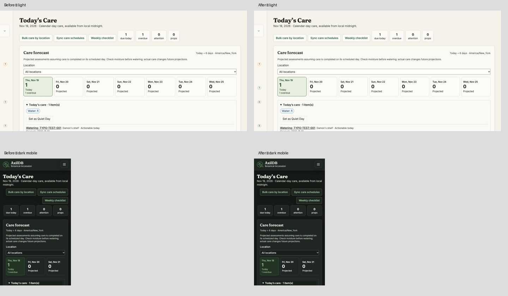
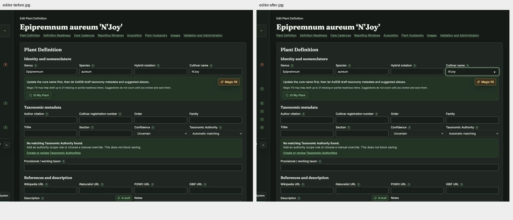
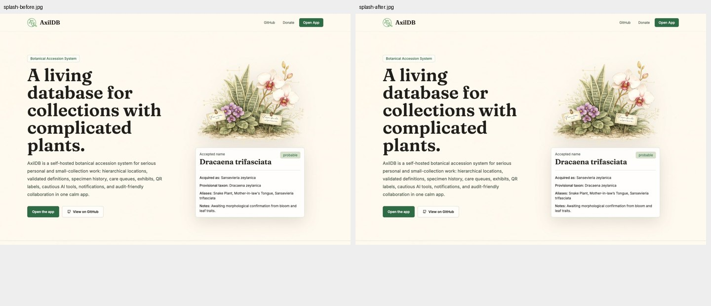
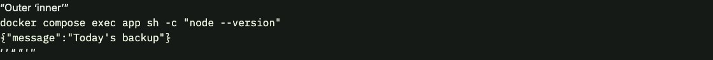

# Typography implementation review — November 19, 2026

Starting revision: `fb61035f97d6daf9fe410163af699b936d786091`. The implementation commit is the commit containing this report. Deployment is through the existing Web deployment: no migrations, host agent changes, new dependencies or production operations.

## Scope and decisions

Source review covered the application’s TSX routes and components, shared naming/typography/theme infrastructure, AI review and Magic Fill, dashboard Markdown, exhibit Markdown, email/push display boundaries, label and care-sheet/exhibit/wishlist PDF paths, and search consumers. The in-repository `/splash` is covered, including its public marketing host behavior. No separate marketing repository was required or changed. The shared Help/manual source and generated Markdown were reviewed; existing literal technical examples and historical screenshot assets were retained. External authority text and external websites remain literal/outside this application.

The syntax-aware source audit covers 377 source files and found 32 starting prose-copy candidates, now corrected; one size placeholder was also typeset with a prime. Static corrections include Today’s Care, dashboard greetings and briefing copy, help text with cultivar examples, account confirmations, collection descriptions, public splash prose, terms and AI-spend labels. Dynamic formatting is explicitly applied to botanical names, prose descriptions, notes/captions, care rationale, AI review values and explanations, husbandry, acquisition summaries, care sheets and narrative workflows. Dynamic reminder, workflow, care-sheet, exhibit and other read-only prose titles follow the same standard. User-controlled location/collection names, handles and identifiers remain exact in their direct display fields.

A distinct botanical display API preserves the canonical name functions. Existing records, identity, accession codes, taxonomic matching requests, source evidence, inputs, option values, raw JSON editors, logs, manifests, CSVs and clipboard commands are not rewritten. Display formatting is deterministic, idempotent for tested supported inputs and runs before rendering. No global runtime scanning, new dependency, added AI request or paid operation is involved.

Search equivalence is narrowly applied to human-readable comparisons. Numeric quotes are converted to primes only in explicit measurement mode; ordinary prose does not guess whether `12"` means inches. Existing explicit unit labels remain valid and unchanged.

## Validation

- Formatter tests cover 30 prose fixtures, repeated formatting, cultivar outer pairs/internal apostrophes, Unicode preservation, null/empty inputs, nested quotes, leading elisions/years, whitespace, Markdown fences/code/links, HTML tags, literal commands, measurements, search expansion, immutable canonical records, email escaping and unchanged fixed label dimensions.
- Syntax-aware audit tests cover detection, input/URL/code exclusions and documented exceptions; the source audit passes.
- TypeScript passes. Production build passes separately.
- Workflow, care scheduling, cadence inheritance, optimistic queue concurrency/retry, measurement units, Magic Fill, plant identity, tags, completeness, provenance, treatment, substrate, taxonomic authority and domain-event checks pass.
- Label preference/download and accepted light/dark theme checks pass. Existing theme tokens remain unchanged.
- The full `check:production` run stops at `check:collection-scope`. Its ten reported call sites were verified against the starting revision and are all pre-existing. No scope exceptions or unrelated authorization changes were made. The subsequent default-collection check passes separately.
- Next core-web-vitals lint was compared for all changed tracked TS/TSX files against the starting revision: no new findings. The repository has no committed lint configuration; this was a temporary legacy-config comparison, not a claim that the baseline is lint-clean.
- The formatter processed 20,000 representative strings in approximately 25–30 ms locally. This is a microbenchmark, not a production load-test or a cross-device guarantee. Work is proportional to rendered text and no repeated DOM traversal is used.

Browser/PDF results and final evidence inventory are recorded in `validation.json` after verification. Browser tests use isolated PostgreSQL fixtures only, block external requests and send no emails, AI requests or deployments. They exercise real app rendering, not screenshots of production data.

## Evidence and limitations

The compact review includes representative screenshots; the complete local gallery and PDFs are linked in `validation.json`. Baseline screenshots were captured from the existing production build at the starting revision with the same primary isolated plant data. An additional long-name/prime specimen and AI proposal were added for after-only checks; their extra sidebar counts are fixture differences, not behavior changes. After captures use the updated production build. Theme/mobile comparisons include actual Care Queue content and the reported heading. Other captures cover definitions, an instance, editor, splash and labels, with further AI/literal/print checks.

Visual browser coverage is representative rather than every conditional branch of every route. Chrome desktop emulation is used; Safari, Firefox, physical label printers and screen-reader punctuation preferences were not tested. The PDF files are rendered/inspected separately; no claim is made about physical printer calibration. Very long names remain subject to the existing compact-label minimum-size/layout limits; the refinement does not redesign label templates.

Technical exceptions are intentional, not incomplete prose conversion. Ambiguous punctuation remains unchanged where meaning cannot be determined. Other locales bypass the English formatter. The application has no full Markdown/MDX engine; existing minimal renderers retain their scope, with code protection added. Raw stored AI/provider payloads and exact evidence remain unformatted.

Maintenance guidance: [Typography convention](../../TYPOGRAPHY.md).

## Review images

Final browser verification passed 11 after route/theme/viewport captures plus the literal fixture; 9 baseline captures are retained. Fifteen final PDF cases passed text extraction, required glyph and page-bound checks. This includes all six label format/orientation combinations for both ordinary and long/prime names, plus care-sheet, exhibit and wishlist PDFs. The full local gallery is recorded in `validation.json`; only compact representative images are committed.
